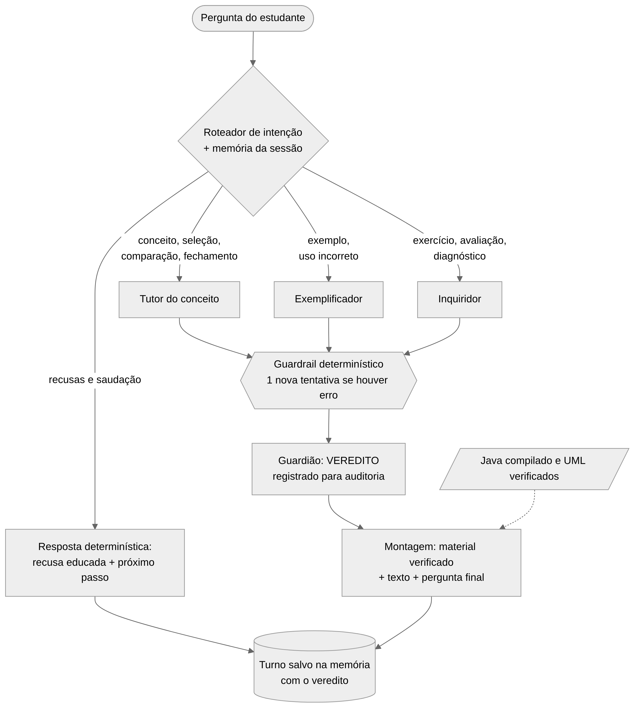

# Arquitetura

## Coordenação e fluxo de um turno

O sistema usa o processo **sequencial** do CrewAI. Em cada turno participa **um agente autor**, escolhido pela intenção da pergunta, seguido do **Guardião**. Pedidos combinados (por exemplo, 'explique e dê um exemplo') acrescentam autores na ordem Tutor → Exemplificador → Inquiridor. A Figura 1 resume o fluxo; os passos são:

- **1. Entrada e memória.** A CLI valida a entrada (vazia gera erro amigável) e carrega a sessão (`memoria/sessoes/<id>.json`).
- **2. Roteamento.** `fluxo_heuristico.py` classifica a pergunta em uma de 16 intenções e detecta o nível declarado ('sou iniciante').
- **3. Barreiras determinísticas.** Saudação, pedido para inventar padrão, nome de padrão inexistente (conferido contra um catálogo de nomes), outro padrão do GoF, pedido de solução pronta e assunto fora do escopo recebem uma resposta pedagógica fixa, sem chamar o modelo.
- **4. Plano do turno.** Conceito, seleção, comparação e fechamento vão para o Tutor; exemplo e uso incorreto, para o Exemplificador; avaliação de tentativa, esclarecimento e diagnóstico, para o Inquiridor. Um pedido de exercício recebe o próximo enunciado do banco verificado, sem chamar o modelo. O sistema escolhe o material verificado (código Java compilado, diagrama UML, fatos do exemplo e gabarito do exercício em andamento).
- **5. Crew.** A tarefa do autor tem um guardrail determinístico: se o texto tiver um problema objetivo, o CrewAI devolve a lista ao próprio agente para uma nova versão (uma vez). A tarefa do Guardião recebe o texto pelo `context` e devolve o veredito.
- **6. Registro do veredito.** O veredito e os problemas apontados ficam registrados. Existe uma crew de reescrita (o autor recebe a versão anterior e os problemas), mas ela vem desligada por padrão: nas três coletas com o modelo real ela piorou mais respostas do que corrigiu (seção 3.1).
- **7. Montagem e memória.** O fluxo junta material verificado e texto, garante que a resposta termine com uma pergunta e salva o turno (intenção, agentes, veredito, exemplo mostrado, nível).



**Informações que circulam:** a pergunta e a intenção vão para todas as tarefas; o histórico só vai quando a pergunta depende dele (tentativas, 'no exemplo anterior'); o enunciado do exercício em andamento fica reservado na memória; a saída do autor vai ao Guardião pelo `context`; o veredito volta ao fluxo, que decide a reescrita.

**Reação a dúvidas, erros e pedidos fora do escopo:** respostas curtas como 'não entendi' durante um exercício viram esclarecimento do Inquiridor; uma tentativa ('minha resposta: ...') é avaliada contra o enunciado salvo, sem que o sistema declare acerto sem evidência; pedidos fora do escopo recebem redirecionamento educado com um próximo passo sobre Factory Method.

## Módulos

```text
ia-factory/
  README.md                 instalação, execução, testes
  requirements.in           dependências diretas
  requirements.txt          138 pacotes com versões fixadas (Windows e Linux)
  agente/                   pacote Python (python -m agente)
    __main__.py             CLI obrigatória e modo interativo
    fluxo.py                orquestração de um turno
    fluxo_heuristico.py     roteador de intenções e barreiras anti-alucinação
    crew.py                 agentes, tarefas e crews do CrewAI
    verificacao.py          guardrails determinísticos e leitura do veredito
    llm.py                  LLM local (Ollama /api/chat, num_ctx, temperatura)
    memoria.py              memória por sessão em JSON
    recusas.py              recusas educadas e boas-vindas
    catalogo.py             nomes e intenções dos padrões GoF
    conhecimento.py         exemplos Java, fatos, UML e exercícios
    agentes/                leitura de ROLE, GOAL e BACKSTORY dos prompts
    prompts/                tutor.txt, exemplificador.txt, inquiridor.txt, guardiao.txt
    referencias/            factory_method.md, estrutura_uml.txt e 4 exemplos .java
    web.py                  interface web opcional
  tests/                    test_unitarios.py, test_perguntas_pdf.py, ollama_simulado.py
  caderno/                  avaliar_sistema.py, rubrica.md, avaliacoes/
  docs/                     agentes.md, arquitetura.md, memoria.md
  frontend/                 HTML, CSS e JS da interface web
```
